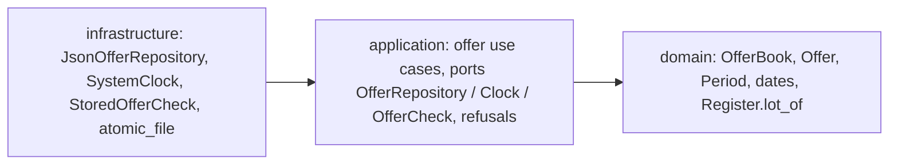

# Architect: owner offers a space (F2.1)

## TL;DR
The structure fits ADR-0001 (rings unchanged). Offers get a third JSON file, a `Clock` port and an `OfferCheck` port; the owner role and a declared name identify the offerer. Everything cheap is decided below and recorded in ADR-0004 (accepted). All questions are answered (see below).

## Where the code lives (ADR-0001)
- `domain/dates.py`: `parse_date(value)` (a `date` or ISO text; anything else is an unreadable date), shared later with E5 S2. `domain/offers.py`: `Period(start, end)` (whole calendar days, both included, end not before start, start not before today), `Offer(number, space_number, period)`, `OfferBook` (`add`, `withdraw`, `open_offers(today)`, `has_open_offer(space_number, today)`, `next_number`). New domain errors: `InvalidPeriod`, `StartInPast` (both refused as invalid input, PRD 15), `OverlappingOffer` (carries the existing offer number), `UnknownOffer`.
- `domain/register.py`: one additive public method, `lot_of(space) -> Lot` (the owner is read from the register at each use, D-56). Nothing existing changes.
- `application/ports.py`: `OfferRepository` (`load() -> OfferBook`, `save`), `Clock` (`today() -> date`), `OfferCheck` (`has_open_offer(space_number) -> bool`). `application/offer_use_cases.py`: `offer_space`, `withdraw_offer`, `list_open_offers`. `application/refusals.py`: `NotAllowedToOffer`, `NotTheOwner`, `InvalidPeriodRefused`, `OverlapRefused`, `UnknownOfferRefused`, `SpaceOfferedRefused`, `OffersUnreadable(StoreUnreadable)`.
- `infrastructure/json_offer_repository.py`, `SystemClock` and `StoredOfferCheck(repository, clock)` in `wiring.py`, with factories; the atomic write is the existing `atomic_file.py`.

## Decisions (cheap to reverse)
- **Offerer identity (PRD open question)**: `offerer` name is an argument of the request; the check compares it, with `key()`, to the owner of the space's lot. Role `OWNER` only (`_require_owner`, first check, as D-16). Limit stated in the docstring and ADR-0004 (AC14).
- **Clock**: a port, not `date.today()` in the code; the fixed clock is a fake in `tests/fakes.py`. Adapter = local date of the host. Dates are `datetime.date` or ISO text; no time of day, so no time-zone handling (as the rules skeleton).
- **Offer storage**: a third file, apart (PRD 13: register and rules untouched, no migration). Own aggregate and lifecycle, as the rules. Format in ADR-0004. The offer stores the space number, not the owner or the lot (owner is the register's, D-56). Withdrawn = deleted; numbers are integers from `next_number`, never reused, so a stale number can never designate someone else's offer (D-55). Expired offers stay in the file and are filtered by the clock (no purge). On load: bad JSON or shape, a bad date, a duplicate number, or a number at or above `next_number` is `OffersUnreadable`. Two stored offers of one space sharing a day are tolerated on load (the pair stays listed) and checked only when adding (D-63, D-64: the refusal names the earliest-start overlapping offer, ties by lowest number); nothing can repair such a file before S3 (withdraw), so refusing to load it would lock the feature.
- **Removal check that sees offers**: `RentalCheck` untouched; new port `OfferCheck`; `remove_space(repository, rentals, offers, role, number)` is 5 parameters (INV-006). Order: manager, unknown space, rental, then open offer ("space offered", never "rented", AC3). It fails closed: an unreadable offers file raises `OffersUnreadable` and nothing is removed. The signature change is forced by D-51 and no alternative avoids it (a composite `RentalCheck` would conflate the two reasons, PRD 14; an optional parameter would be fail-open).
- **Use case signatures (INV-006)**: `offer_space(registers, offers, clock, role, request)` with `OfferRequest(space, offerer, start, end)`; `withdraw_offer(registers, offers, clock, role, request)` with `WithdrawRequest(offerer, number)`; `list_open_offers(registers, offers, clock)` (no role, D-17). Check order in `offer_space` (PRD 15): role, period (dates readable, end not before start, start not before today), unknown space, owner, overlap (`OfferBook.add`, last). A refusal never reaches `save`.
- **Public type**: `OfferEntry(number: int, space: str, lot: str, owner: str, start: date, end: date)`, frozen, like `LotEntry`; the list is sorted by start, then `natural_key(space)` (offers of one space never overlap, so the order is total). `offer_space` returns the new `OfferEntry` so the owner has the number to withdraw it.
- **Security**: signals = two new entry points, an owner check on a weak identity. Trust boundary and authorization stay in `application`, role first. No sensitive data beyond the owner name already in the register. Open offers listing writes nothing. Performance: none stated, none invented; whole-file rewrite is adequate.

## Answers from the human
- **Concurrency: option A.** Single process, no lock, as ADR-0002. Limit stated: several owners write offers, so two simultaneous calls can both pass the overlap check and break "no two open offers on one day"; nothing prevents it. A lock belongs to the adapter that introduces concurrency (ADR-0004).
- **Renumbering a space with an open offer is refused as "space offered"**, through `OfferCheck`: `change_space_number` gains the `offers` parameter (a second breaking signature change, like `remove_space`); new AC in S4, recorded by the Product Owner.
- **Withdrawing an expired offer is refused as unknown offer**: `withdraw_offer` takes the clock (`withdraw_offer(registers, offers, clock, role, request)` with `WithdrawRequest(offerer, number)`, 5 parameters).

## For the harness engineer
- Sensitive zones to add: the role check of the offer use cases (`offer_use_cases.py`, owner only, ADR-0004); the offers write path (`json_offer_repository.py`, atomic write); the fail-closed removal check (`StoredOfferCheck` and the `OfferCheck` call in `remove_space`: no `except` around it, unreadable offers must stop the removal).
- Candidate executable rule: `domain` and `application` never read the system date (`date.today()`, `datetime.now()`), the clock is injected; checkable by scanning calls in those rings.
- INV-001 and INV-007 already cover the new files (same rings).

## For the planner
Order follows the stories. S1 brings `dates`, `Period`, `OfferBook`, `Register.lot_of`, the three ports, the repository, the clock, `offer_space`, `list_open_offers`, the refusals. S2 brings `OverlappingOffer` and the overlap rule in `OfferBook.add`. S3 brings `withdraw_offer` and `UnknownOffer`. S4 brings `OfferCheck`, `StoredOfferCheck`, the changed `remove_space` signature (existing tests and callers follow).
