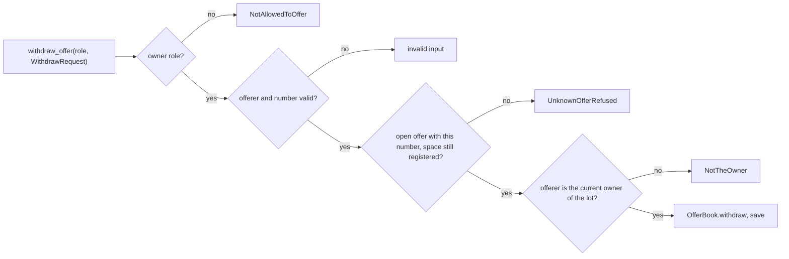

# S3 Withdraw an offer

## TL;DR
S3 adds `withdraw_offer`: the owner withdraws an open offer by its number, the offer is deleted from the offers file, its dates are free again. Q1 to Q3 are answered by delegate (D-65, D-66, D-67). M1 is deferred to S4 (said below); M2 is for the Product Owner; the tie order of a stored pair (review 07 m1) is taken here.

## 1. Metadata
- **Type**: feature (prompt, no ticket)
- **Date**: 2026-11-11
- **Status**: in-progress

## 2. Goal
The owner who offered a space takes the offer back, designating it by the number the listing shows. The offer leaves the list and the offers file, no longer blocks another offer of the same space on the same days, and its number is never reused. Every refusal changes nothing.

## 3. Context
- Built by S1 and S2: `OfferBook` (`restore`, `add`, `offers`, `open_offers`, `next_number`) in `domain/offers.py`; `offer_space`, `list_open_offers`, `OfferEntry`, `_require_owner`, `_entry` in `application/offer_use_cases.py`; `NotAllowedToOffer`, `NotTheOwner`, `OverlapRefused`, `OffersUnreadable` in `application/refusals.py`; `_REFUSALS` and `_refuse` in `application/use_cases.py`; `JsonOfferRepository`; fakes `InMemoryOfferRepository`, `FixedClock` in `tests/fakes.py`.
- Architect (`../architect.md`, ADR-0004): `withdraw_offer(registers, offers, clock, role, request)` with `WithdrawRequest(offerer, number)` (5 parameters); `OfferBook.withdraw`; `UnknownOffer` (domain) and `UnknownOfferRefused` (application); a withdrawn offer is deleted, numbers never reused, expired offers stay in the file (no purge).
- Decisions: D-51 (owner may withdraw), D-54 (owner only, same name check as offering, designated by number), D-55 (already withdrawn: unknown offer), D-58 (ended: unknown offer), D-52 (open until its end day included), D-56 and D-46 (the owner is the lot's current owner, read from the register at each use, so after a correction the new owner withdraws and the old name does not), D-59 (blank or non-text offerer: invalid input, after the role), D-61 (numbers never reused), D-62 (the listing skips an offer whose space left the register), D-19 (unreadable store: named error, never overwritten). D-65 (refusal order, orphan offer = unknown offer), D-66 (unusable number or offerer = invalid input), D-67 (returns the withdrawn `OfferEntry`).
- Invariants: INV-001 rings (domain imports no application), INV-002 each test-case names a real test, each test has a test-case, INV-003..006 (`withdraw_offer` stays at 5 parameters, 40 lines, complexity 10: extract helpers if needed), INV-007 mutation score of the critical scope at least 90, INV-008 no system date in `domain`/`application` (`withdraw` receives `today`, never reads it).
- Sensitive zones (a diff escalates to the human): `application/offer_use_cases.py` (role check, and a new owner-only write entry point). `json_offer_repository.py` and `atomic_file.py` are not touched: the adapter saves whatever book it is given. `_REFUSALS` in `use_cases.py` gains entries; the zone there ("OfferCheck call in `remove_space`") is S4's and is not touched.
- Carried over: **M1 (orphan offers) is deferred to S4**, which blocks the removal and renumbering of a space with an open offer; S1, S2 and S3 must not be released without S4. m1 of review 07 (tie order of a tolerated stored pair) is taken in step 4. **M2 of review 07** (wording of the overlap refusal) is a one-line decision for the Product Owner in `docs/business/decisions.md`: consumers rely on `offer_number`, not on the sentence; the same line should cover the new refusals of S3. The developer does not edit `decisions.md`.
- Lessons: no `.plans/FEEDBACK.md`.

## 4. Expected behaviors
Boundary: `withdraw_offer(registers, offers, clock, role, request)` with the fakes, read back through `list_open_offers`; persistence checks over `JsonOfferRepository(path)` on a temp dir. D-65 to D-67 settle the edges.
- AC1 nominal: given offer 1 of P1 by Durand (lot A12), when `Role.OWNER` withdraws number 1 as "Durand", then the list is empty and the call returns the `OfferEntry` it withdrew (D-67). Name compared ignoring case and surrounding spaces. With offers 1, 2 and 3, withdrawing 2 leaves exactly 1 and 3 in the same order.
- AC1 owner is the current one (D-56): after `change_lot_owner(A12, "Moreau")`, "Durand" is refused as not the owner and "moreau" withdraws.
- AC2: given offer 1 of P1 from 20 to 25, when it is withdrawn, then an offer of P1 from 22 to 30 is accepted and gets the next number (not 1); the other space and the other offers are untouched.
- AC3 unknown offer: a number that never existed, an offer already withdrawn (second call with the same request) and an offer whose end date has passed (clock the day after its end) are each refused as `UnknownOfferRefused`; an offer ending today is still open and is withdrawn. An offer that starts in the future is withdrawn like any other.
- AC3 order and edges (D-65, D-66): a non-owner naming a closed offer gets unknown offer; an offer whose space left the register is unknown offer (D-65); a number that is not a whole number from 1, or a blank or non-text offerer, is invalid input (D-66); a whole number matching no open offer stays unknown offer.
- AC4: a name that is not the owner (another owner, the owner of another lot, a name of the manager) is refused as `NotTheOwner`; any role other than owner (manager, resident, `None`, a string, an integer) is refused as `NotAllowedToOffer` first, with the clock and both stores untouched (fed with unreadable stores and invalid input).
- AC4 rank: role, then invalid input, then unknown offer, then not the owner; each tested with the later ones also present.
- AC5 refusals: after each refusal the list, the register and (real repository) the offers file bytes are unchanged, `next_number` included, and the offers store has not been saved.
- AC5 restart: with the real repository, the withdrawn offer is gone from the file after a re-read, `next_number` is unchanged, the next offer gets the number it would have had, and an expired offer of another space is still in the file (no purge). The register file and the rules file are not modified.
- AC5 unreadable: with unreadable offers, a valid withdrawal ends with `OffersUnreadable` (a store error, not a `Refusal`), nothing written; with an unreadable register, `StoreUnreadable`. Invalid input and a non-owner role are refused before any store is read.
- One clock read per call (as S1).
- Carried m1 and the repair of a stored pair (D-63): given a file holding two open offers of one space with the same start (written directly), the listing orders them by offer number; withdrawing one leaves the other listed, and the freed days accept a new offer unless the remaining one still shares them.
- Interface edges of `withdraw_offer` and `WithdrawRequest`: called twice (second: unknown offer); called with nothing (`None` offerer or number: invalid input, D-66); invalid value (D-66); edge of range (end today, number 1, the highest number); different order (withdraw 1 then 2, or 2 then 1: same final list; withdrawing then offering again on the same days).

## 5. Steps
Tests first; run `python3 -m unittest discover -s tests` after each step.
- [x] Step 1: test-cases. Write `docs/business/test-cases/offer-a-space/s3-*.md`, one per behavior above (`status: pending`, `source: stories.md S3 ACn` or the decision), including `s3-stored-pair-tie-order-and-repair.md`. No existing test-case changes.
- [x] Step 2: domain. `domain/errors.py`: `UnknownOffer(DomainError)`, and `InvalidOfferNumber(DomainError)` (a number that is not a whole number from 1, `bool` excluded, D-66). `domain/offers.py`: `OfferBook.open_offer(number, today) -> Offer` (raises `UnknownOffer` for a number that is not open) and `OfferBook.withdraw(number, today) -> Offer` (removes it from the stored offers; `next_number` unchanged; other offers, expired ones included, kept).
- [x] Step 3: application. `application/refusals.py`: `UnknownOfferRefused(Refusal)` and `InvalidOfferNumberRefused(Refusal)`; register both in `_REFUSALS` (`use_cases.py`). `application/offer_use_cases.py`: `WithdrawRequest(offerer, number)` and `withdraw_offer(registers, offers, clock, role, request) -> OfferEntry` (D-67): `_require_owner`; one `clock.today()`; clean the offerer and validate the number; load the offers, `open_offer`; read the lot of the offer's space from the register, a space that left the register is an unknown offer (D-65); compare names with `key()`; `withdraw`; `save`; return `_entry`. A refusal never reaches `save`. Reword the `_require_owner` message to cover both actions. Tests in `tests/test_offer_use_cases.py` (new classes `WithdrawRules`, `WithdrawRefusalOrder`, `WithdrawStores`) for all behaviors above; fakes need no change.
- [x] Step 4: infrastructure and ordering. No code in `infrastructure/`. Tests in `tests/test_json_offer_repository.py`: restart after a withdrawal, bytes unchanged after each refusal, expired offer kept, `next_number` kept, unreadable file untouched. Test in `tests/test_offer_use_cases.py` (or the repository file, where a stored pair can be written) for the tie order of a stored pair and its repair (review 07 m1).
- [x] Step 5: docs and checks. Fill `automated_test`, `status: covered`; update `s2-stored-overlap-is-tolerated.md` only if its text is no longer true. Run `bash tools/harness/run_all.sh`, the unit suite, `python3 -m unittest discover -s tools/harness/selftest` and `python3 tools/harness/run_mutation.py --scope critical` (the `--scope diff` call is a no-op in this nested folder, review 07 m2, so do not rely on it).

## 6. Risks & edge cases
- A missed or weakened role check lets any role withdraw: the first statement of `withdraw_offer` is `_require_owner`, and a test feeds every non-owner role with unreadable stores.
- Withdrawing an offer by a non-owner leaks nothing more than the public listing shows, but an offer that is closed, withdrawn or orphaned must look the same (unknown offer) to everyone.
- The deletion must not drop other stored offers (expired ones, a stored overlapping pair, the other space's offers), nor reset `next_number`: one test each.
- A comparison on `open_offers` order instead of on the number would withdraw the wrong offer when two offers tie on start and space (stored pair): the number is the only key.
- Concurrency: two simultaneous withdrawals or a withdrawal during an offer are not prevented (ADR-0004 limit, not tested).
- Orphan offers (M1): until S4, an offer whose space left the register cannot be withdrawn under D-65; if the number is registered again the new owner sees and can withdraw it.
- Reusing `NotAllowedToOffer` for a withdrawal: the name reads "offer" but the story says "refused as not allowed"; the message covers both.

## 7. Out of scope
S4 (`OfferCheck`, `remove_space` and `change_space_number` signatures, M1); a purge of expired offers; price; requests and rentals; a lock for concurrent callers; cleaning orphan offers; the decision-log lines (Product Owner).

## 8. Deviations
None from the plan. Two details the plan left open, chosen by the developer: the number validation is a domain function `offer_number(value)` in `domain/offers.py` (raises `InvalidOfferNumber`), called by the use case before any store is read; and `OfferBook.open_offers` now adds the offer number to its sort key, so the tie order of a stored pair (review 07 m1) is explicit instead of resting on the stable sort.

## 9. Self-review
(empty)

## 10. Follow-up actions
(empty)

## Technical choices (for the reviewer)
- `OfferBook.open_offer` and `withdraw` both take `today`, so "open" is judged in the domain with the single clock read of the use case (as `add`); the use case finds the offer first, checks the owner from the register, then withdraws.
- The unknown-offer test uses the number only; the listing order plays no part in finding an offer.
- `UnknownOffer` is mapped through `_REFUSALS` (it carries nothing more than its message), unlike `OverlappingOffer`.
- `NotAllowedToOffer` and `NotTheOwner` are reused for withdrawals: one refusal per reason, whatever the action.
- No change to `json_offer_repository.py`: the adapter saves the whole book, so a deletion needs no code there.
