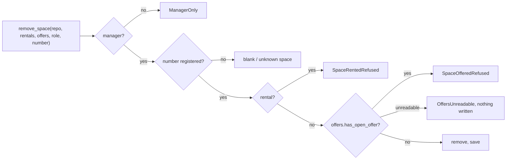

# S4 A space with an open offer cannot be removed or renumbered

## TL;DR
S4 makes `remove_space` and `change_space_number` ask a new `OfferCheck` port and refuse an offered space as "space offered" (fail closed: unreadable offers stop the write). Two public signatures break (listed in step 3). The same story closes M1 for new data, settles M2 of review 08 (unknown offer vs unreadable register) and takes the `from None` minor. Open points settled by delegate: D-69 (orphans already stored), D-70 (M2), D-71 (renumbering edges).

`change_space_number(repo, offers, role, number, new_number)`: manager, then the register's own refusals (blank, unknown, duplicate), then the same offer check on the old number, then save.

## 1. Metadata
- **Type**: feature (prompt, no ticket)
- **Date**: 2026-11-11
- **Status**: in-progress

## 2. Goal
A manager can no longer remove, or give another number to, a space that people can see on offer: the register refuses with a named reason ("space offered"), unchanged. Once the offer is withdrawn or past its end date, both actions work again. The refusal comes after the rental refusal (an offer is not a rental) and never when the offers cannot be read: then the write stops with the offers-unreadable error.

## 3. Context
- Built by S1 to S3 (committed): `OfferBook` (`restore`, `add`, `open_offer`, `withdraw`, `open_offers`) in `domain/offers.py`; `Register.space`, `lot_of`, `remove_space`, `change_space_number` in `domain/register.py`; `remove_space(repository, rentals, role, number)` and `change_space_number(repository, role, number, new_number)` in `application/use_cases.py`; `RentalCheck` and `NoRentalYet`/`rental_check()`; `OfferRepository`, `Clock`, `JsonOfferRepository`, `SystemClock`/`system_clock()` in `infrastructure/wiring.py`; fakes `StubRentals`, `InMemoryOfferRepository`, `FixedClock`.
- Architect (`../architect.md`, ADR-0004): new port `OfferCheck.has_open_offer(space_number) -> bool`; `StoredOfferCheck(repository, clock)` with factories in `wiring.py`; `RentalCheck` untouched; order manager, unknown space, rental, open offer; fail closed (no `except`); `remove_space` is 5 parameters; `change_space_number` gains the same port (human answer, D-57).
- Decisions: D-51 (a space with an open offer cannot be removed), D-57 (renumbering refused as "space offered"), D-50 (an offer is not a rental), D-52 (open until the end date included), D-62 (the listing skips an offer whose space is gone), D-65 (such an offer is an unknown offer for withdrawal), D-19 (unreadable store: named error, never overwritten), D-14 (a refusal is a named type), D-16 (role first).
- Invariants: INV-001 (rings: `OfferCheck` in `application/ports.py`, the adapter in `infrastructure`; the domain imports no application), INV-002 (every test-case names a real test and the reverse), INV-003..006 (both signatures stay at 5 parameters, 40 lines, complexity 10), INV-007 (mutation score of the critical scope at least 90), INV-008 (no system date in `domain`/`application`: `has_open_offer` receives `today`, the adapter reads the clock port).
- Sensitive zones (a diff escalates to the human): the manager-only role check (`remove_space`, `change_space_number`), the fail-closed `OfferCheck` call in both (invariants.md, "Not written yet" until this story), the offers write path (not touched: `json_offer_repository.py`, `atomic_file.py` stay as they are), and `offer_use_cases.py` (step 5 edits `withdraw_offer`, a role-check file).
- Carried over: **M1** closed for data written from now on by AC1 and AC6 (no use case can create an orphan any more); orphans already stored are settled by D-69. **M2 of review 08** is settled by D-70 (code, test, test-case text). **Minors taken**: `from None` on the unknown-offer refusal (m3), and the order of blank offerer vs bad number is in D-70 (m1; already pinned by a test).
- Lessons: no `.plans/FEEDBACK.md`. From reviews 06 to 08: tests that make a port answer `bool` must assert `True`/`False` exactly (mutation), refusals leave the files byte-identical (real repository), `--scope diff` is a no-op here, use `--scope critical`.

## 4. Expected behaviors
Boundary: `remove_space(repository, rentals, offers, role, number)` and `change_space_number(repository, offers, role, number, new_number)`, with `InMemoryRepository`, `StubRentals` and `StubOffers` (new, records the numbers it is asked, like `StubRentals`) for rank and call-order; with `offer_check(InMemoryOfferRepository, FixedClock)` and offers made through `offer_space` for open/ended semantics; with the JSON repositories on a temp dir for bytes and restart. `StoredOfferCheck` is tested through `has_open_offer` (the port's own API).

Removal (AC1 to AC5)
- AC1: given an open offer on P1 (made by `offer_space`), when the manager removes `" p1 "`, then `SpaceOfferedRefused` (a `Refusal`), P1 is still listed, the register is equal and the offers store was not saved; P2 (no offer) is removed normally.
- AC2: given that offer withdrawn (`withdraw_offer`), when P1 is removed, then it succeeds; the same on a space whose offer was one of several and only the others remain open elsewhere.
- AC3: given an open offer on P1 and no rental, the refusal is `SpaceOfferedRefused`, never `SpaceRentedRefused`; given a rental and no offer, `SpaceRentedRefused` (unchanged); given both, `SpaceRentedRefused`, and the offers port is not asked. `rental_check().has_rental` still answers `False`; `NoRentalYet` is untouched.
- AC4: given an offer ending yesterday, removal succeeds and the expired offer is still in the offers file (no purge); ending today, it is refused; starting in the future, it is refused; one expired and one open offer on the space, it is refused.
- AC5: given no offer, every existing removal behavior holds (existing tests pass with `StubOffers()`): case/space-insensitive lookup, returns `None`, lot stays, number reusable, unknown and blank refused, second removal refused.
- Order and calls: any other role (owner, resident, `None`, a string) is refused first and neither port is asked, even with unreadable offers; blank number and unknown space are refused before the offers are read (a store that raises on `load` still gives `BlankValueRefused`/`UnknownSpaceRefused`); the offers port is asked once, with the registered number as stored (`" p2 "` asks `"P2"`), and only for a known, non-rented space.
- Fail closed: given unreadable offers (`UnreadableOffers`, real corrupt file), removing a registered, non-rented space ends with `OffersUnreadable` (a `StoreUnreadable`, not a `Refusal`), the register and (JSON) both files are byte-identical; a port that raises any other exception propagates, nothing removed.

Renumbering (AC6, D-71)
- AC6: given an open offer on P1, `change_space_number(..., "P1", "P9")` is refused as `SpaceOfferedRefused`; P1 keeps its number, the register is equal, the offers store was not saved; once the offer is withdrawn, or the clock is the day after its end, the change succeeds; another space without offer changes number while P1 has an offer.
- AC6 edges (D-71): a same-value or case-only change (`"P1"` to `"p1"`, `" P1 "`) on an offered space is refused too; on a space without offer it is accepted as today (existing test). Rank: other role, then blank new number, unknown space, duplicate new number, then space offered; each tested with the later ones also present (an offered space with a duplicate target gets the duplicate refusal; unknown space with unreadable offers gets the unknown refusal and the offers are not read).
- Fail closed: unreadable offers end a valid renumbering with `OffersUnreadable`, register and files unchanged; the offers port is asked once with the old number of the space, only after the register's own checks passed.

Adapter and withdrawal
- `StoredOfferCheck.has_open_offer(number)`: `True` for an open offer of that space, matching ignoring case and surrounding spaces; `False` (exactly `False`) for no offer, an offer of another space, an offer ended yesterday; `True` for one ending today; one clock read and one offers load per question; an unreadable store raises `OffersUnreadable`, never `False`.
- M2 (D-70): with an unreadable register, a valid withdrawal of any number ends with `StoreUnreadable` (an unknown, ended, withdrawn or open number alike); with both stores unreadable, `OffersUnreadable`; invalid input and a non-owner role stay before any read. The test-case `s3-refuse-unreadable-offers-on-withdraw.md` says so.
- m3: the unknown-offer refusal has no cause and a suppressed context (`__cause__ is None`, `__suppress_context__ is True`) for an unknown number, an ended offer and an orphan alike.
- Orphans already stored (D-69): given a stored offer on a number that is not registered (written directly, as a pre-S4 file), the listing skips it and withdrawing it is an unknown offer (as D-62, D-65); if that number is registered again the offer is listed under the new lot, counts as an open offer (removal and renumbering are refused until its owner withdraws it) and can be withdrawn by that owner. No use case creates an orphan: B1 and AC6 refusals are the proof.
- Interface edges (called twice, nothing, invalid, edge, order): `remove_space` twice, second is unknown space; `None` number is blank; `change_space_number` twice with the same request, second is unknown space or (if the first renumbered) the duplicate/same rules above; `offers=None` is a caller bug and is not given a behavior (no default: the argument is required, so an old four-argument call fails loudly with `TypeError`); end date = today is the edge of "open".

## 5. Steps
Tests first, then code; run `python3 -m unittest discover -s tests` after each step. Steps 3 and 4 each end green: a signature change and all its callers go in one step.
- [x] Step 1: test-cases. In `docs/business/test-cases/offer-a-space/`, write `s4-refuse-removing-an-offered-space.md`, `s4-removal-allowed-after-withdrawal.md`, `s4-an-offer-is-not-a-rental.md`, `s4-ended-offer-does-not-block-removal.md`, `s4-removal-without-offer-unchanged.md`, `s4-removal-refusal-order-and-calls.md`, `s4-unreadable-offers-stop-removal.md`, `s4-refuse-renumbering-an-offered-space.md`, `s4-renumbering-allowed-after-withdrawal-or-end.md`, `s4-renumbering-refusal-order.md` (includes D-71), `s4-unreadable-offers-stop-renumbering.md`, `s4-stored-offer-check.md`, `s4-orphan-offers-already-stored.md` (D-69), `s3-unknown-offer-vs-unreadable-register.md` (D-70), `s3-unknown-offer-has-no-cause.md` (m3); all `status: pending`, `source: stories.md S4 ACn` or the decision. Edit `s3-refuse-unreadable-offers-on-withdraw.md` (exceptions per D-70) and `s3-refuse-orphan-offer.md` ("a stored offer whose space is not registered", no longer "removed"). Nothing else changes.
- [x] Step 2: domain. `domain/offers.py`: `OfferBook.has_open_offer(space_number, today) -> bool`: true when an offer whose end is not before `today` has the same space number, compared with `key(clean(...))` (a pre-S4 file may hold "P1" for a space now stored "p1"). Test at `OfferBookWithdrawal`'s level in `tests/test_offer_use_cases.py` (new class `OfferBookOpenOffer`): ends today, ended yesterday, other space, case/space, empty book, returns exactly a `bool`.
- [x] Step 3: `remove_space`. `application/ports.py`: `OfferCheck(ABC).has_open_offer(space_number: str) -> bool` (docstring: unreadable offers raise, they never answer False). `application/refusals.py`: `SpaceOfferedRefused(Refusal)`. `application/use_cases.py`: `remove_space(repository, rentals, offers, role, number)`: manager, load, `register.space`, rental refusal, then `if offers.has_open_offer(space.number): raise SpaceOfferedRefused(...)`, remove, save; no `try` around the offer call. `infrastructure/wiring.py`: `StoredOfferCheck(OfferCheck)` (`__init__(repository, clock)`; `has_open_offer` loads the book, reads `clock.today()` once, returns `book.has_open_offer(...)`) and `offer_check(repository, clock) -> OfferCheck`. `tests/fakes.py`: `StubOffers(*offered)` (records `asked`, answers `number in offered`). Update every caller of `remove_space` (list below) and write the removal tests of section 4 in `tests/test_use_cases.py` (class `Removal`, stub port), `tests/test_offer_use_cases.py` (new class `RemovalWithOffers`, real semantics through `offer_space`, `withdraw_offer`, `FixedClock`) and `tests/test_json_repository.py` (class `JsonRemoval`: bytes of both files on refusal and on unreadable offers, restart after a removal allowed by a withdrawal).
- [x] Step 4: `change_space_number`. `application/use_cases.py`: `change_space_number(repository, offers, role, number, new_number)`: manager, load, the register's own change in the existing `try`/`except DomainError`, then the `has_open_offer` call outside any `except`, then save. The old number comes from the register before the change; the existing order of the register refusals (blank, unknown, duplicate) does not move. Update every caller of `change_space_number` (list below) and write the renumbering tests of section 4 in the same three test files (`Corrections`, `RemovalWithOffers` or a sibling class, `JsonCorrections`).
- [x] Step 5: `withdraw_offer` (D-70, m3). `application/offer_use_cases.py`: after the role and input checks, load the offers and then the register, then look up the offer and its lot; the unknown-offer refusal is raised `from None`. Tests: `WithdrawStores` (M2 both stores, each unknown/ended/withdrawn/open number), `WithdrawUnknownOffer` (cause chain). Fill the test-cases of step 1 for `s3-*`.
- [x] Step 6: orphans already stored (D-69) and the old orphan tests. In `tests/test_offer_use_cases.py` replace the two `remove_space(...)` calls that create an orphan (lines 145 and 540: `test_an_offer_whose_space_left_the_register_is_not_listed`, `test_an_offer_whose_space_left_the_register_is_an_unknown_offer_for_any_name`) by an offer stored for a number that was never registered (`OfferBook.add` and `offers.save`, as a pre-S4 file); add the re-registration test (D-69).
- [x] Step 7: docs and checks. In `docs/technical/invariants.md`, in the sensitive-zone line on the fail-closed `OfferCheck` call, remove "Not written yet." (the code now exists). Fill `automated_test` and `status: covered` in the new test-cases; run `bash tools/harness/run_all.sh`, the unit suite, `python3 -m unittest discover -s tools/harness/selftest` and `python3 tools/harness/run_mutation.py --scope critical` (score at least 90; each survivor on S4 lines gets a behavior test, not a lowered threshold). Report the sensitive zones touched for the human.

Callers to update (public signatures; there is no caller in `src/` besides the definitions, and no CLI):
- `remove_space(repository, rentals, role, number)` becomes `remove_space(repository, rentals, offers, role, number)`:
  - `tests/test_use_cases.py` lines 191, 197, 198, 203, 205, 212, 213, 216, 221, 226, 230, 234, 241, 249 (class `Removal`, uses `self.rentals`/`rentals`/`rental_check()`; add `self.offers = StubOffers()`).
  - `tests/test_json_repository.py` lines 121, 129 to 132, 138, 141 (class `JsonRemoval`) and 169 (corrupt store loop, `CorruptStore`).
  - `tests/test_offer_use_cases.py` lines 145 and 540 (rewritten in step 6, they create orphans).
- `change_space_number(repository, role, number, new_number)` becomes `change_space_number(repository, offers, role, number, new_number)`:
  - `tests/test_use_cases.py` lines 126, 131, 137, 143, 150, 156, 163, 169, 171 (class `Corrections`).
  - `tests/test_json_repository.py` lines 89, 100 to 103 (class `JsonCorrections`) and 168 (corrupt store loop).
  - `tests/test_register.py` calls `Register.change_space_number`/`remove_space` (domain methods): not affected.
- Docs that name them: `docs/technical/adr/0004-offers-store-clock-and-owner-role.md` already states both changes; `docs/technical/invariants.md` is updated in step 7.

## 6. Risks & edge cases
- The offer call must not sit inside an `except`: a future `except Exception` would turn an unreadable file into "no offer" and let the removal through. One test per use case with a port that raises a non-domain error.
- Wrong rank: asking the offers before the rental, or before the unknown-space check, reads the offers file for a call that was refused anyway (and changes which error a consumer sees). Pinned by the order tests with a raising store.
- A renumbering that keeps the offer number but changes its text breaks the exact space-number comparison in `OfferBook.add` (known, latent: `o.space_number == space`). D-71 refuses every change of an offered space, so S4 adds no new mismatch. Files written before S4 may hold one (a same-value correction was allowed): `has_open_offer` compares with `key()` to be safe; `add` is not changed here (follow-up for the reviewer).
- A bool-ish port answer: `has_open_offer` returning `None`/truthy values must not slip through; tests assert `True`/`False` exactly (lesson from review 04).
- Concurrency: a manager removing a space while an owner offers it can both pass their checks (ADR-0004 limit, not tested).
- The signature change breaks any external caller of the two functions with a `TypeError` at call time: intended (no default, a default would be fail-open).
- Step 5 touches `offer_use_cases.py` (role-check file): the first statement stays `_require_owner`; the escalation is expected.

## 7. Out of scope
A purge or repair of orphan offers (D-69); `register_space` guarding a number that has a stored orphan; the rental logic (E3); the price; a lock; changing `OfferBook.add` to compare with `key()`; the decision-log lines (D-69..D-71 are written), the stories and the README counts (Product Owner and others); the `--scope diff` defect.

## 8. Deviations
- 2026-11-11 / step 4 - clarification, not a departure: the old number of the space is read with a small helper `_registered_number` that answers `None` for a number the register does not hold, so the register's own refusals keep their order (blank new number, unknown space, duplicate) and the offers are asked only after them. Decision taken: kept as the plan's "old number comes from the register before the change".
- 2026-11-11 / step 3 - test support added beyond the plan's list: `FailingOffers` in `tests/fakes.py` (raises a given error when asked), used for the "not read" and "fail closed with another error" tests. No source impact.

## 9. Self-review
(empty)

## 10. Follow-up actions
(empty)

## Technical choices (for the reviewer)
- `OfferBook.has_open_offer(space_number, today)` takes `today` like `add`, `open_offer` and `withdraw`; the adapter holds the clock port, so the use cases never see a date (INV-008).
- `OfferCheck` takes one space number and returns a `bool`; the adapter normalizes with `key(clean(...))`, so a caller may pass the number as typed or as stored.
- `StoredOfferCheck` loads the book on each question (no cache): the offers file may change between two calls of a long-lived process.
- `offers` sits right after the rental port in `remove_space` and right after the repository in `change_space_number`: ports first, then role and values; an old call fails loudly.
- In `change_space_number` the offer check runs after the register's own change, on the in-memory register, so a refusal needs no undo and the order blank, unknown, duplicate, offered follows from the code.
- Tests use `StubOffers` for rank and call-order, `offer_check(InMemoryOfferRepository, FixedClock)` for what "open" means, and the JSON repositories only for bytes and restart.
- `UnknownOfferRefused` raised `from None` for every case: one refusal, one shape, nothing about the cause leaks.
