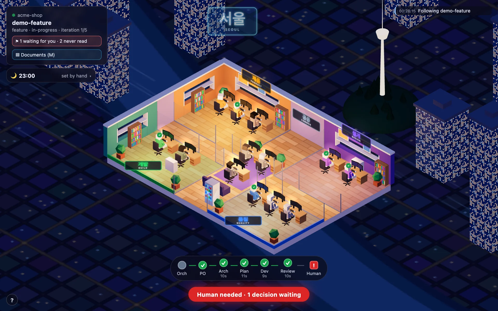
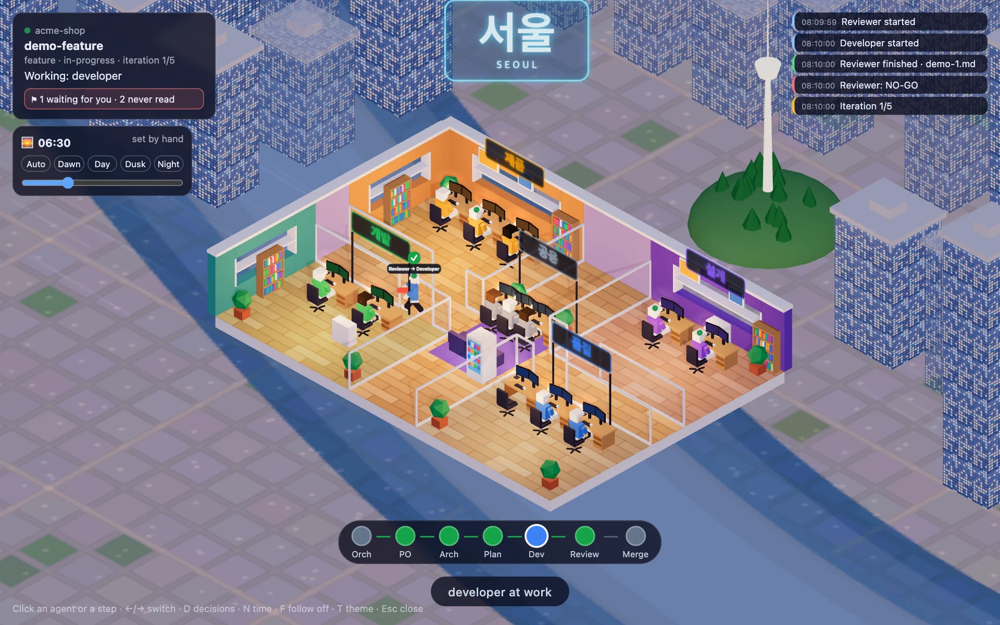
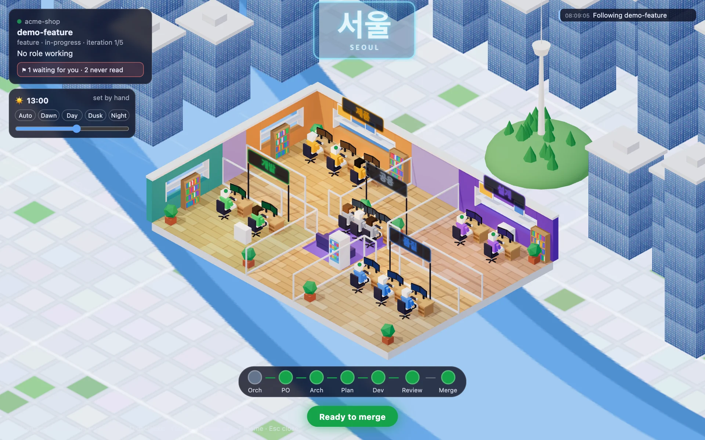
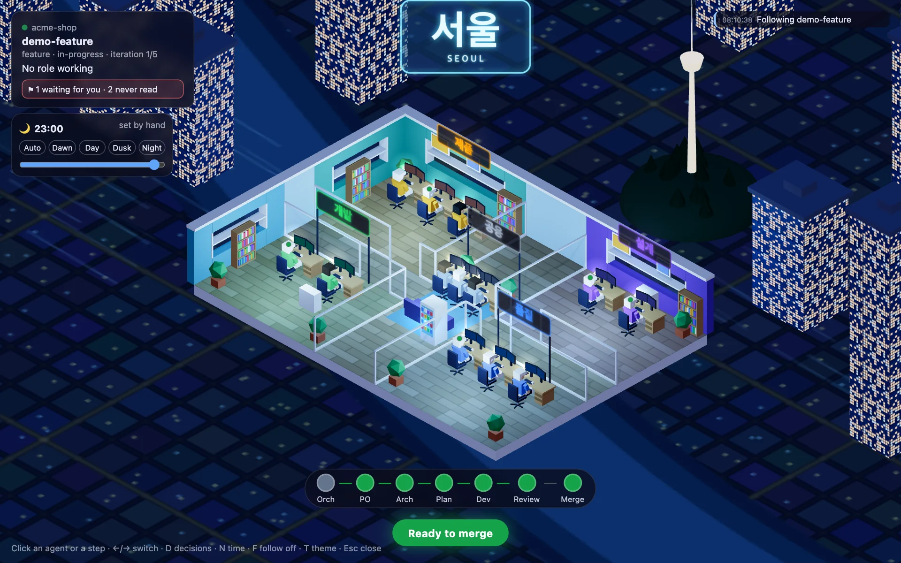
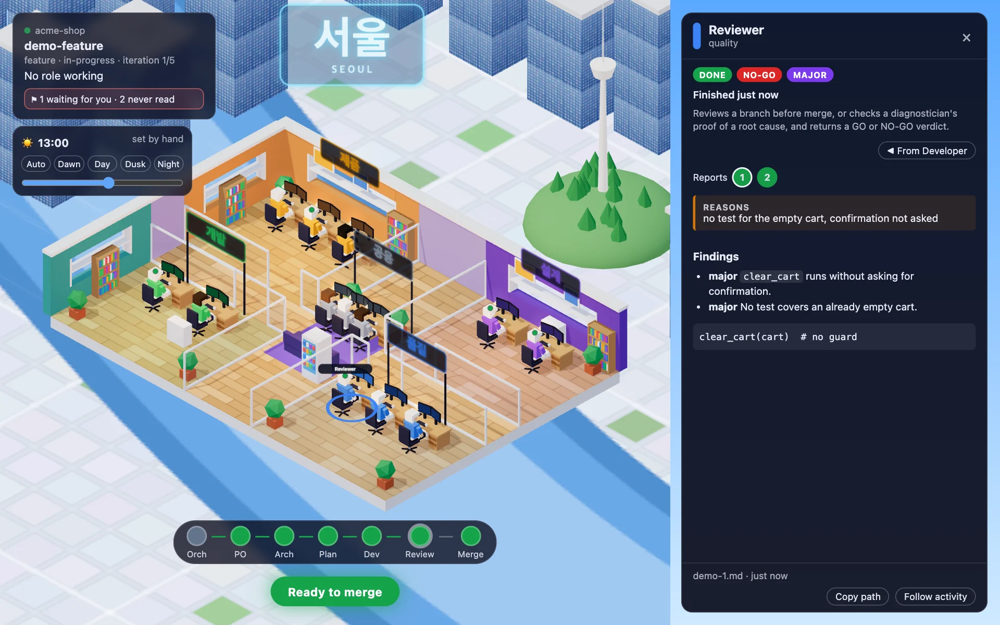
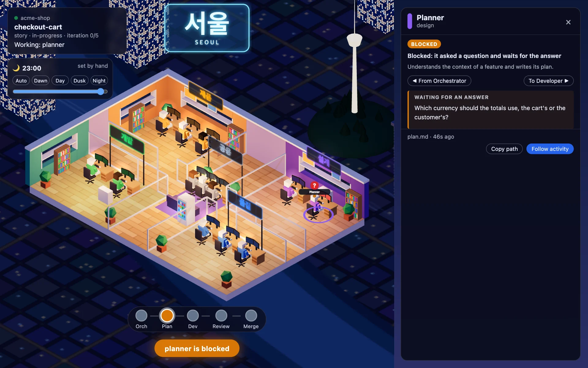
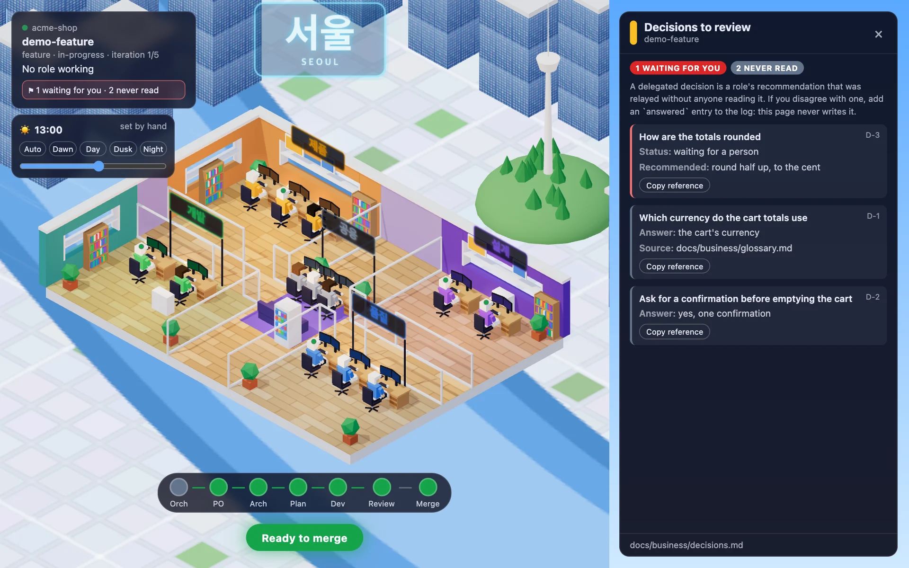

# Office floor

A local web page that shows the roles of [`agents/`](../../agents) working, live, on one isometric office floor floating above Seoul, by day and by night. Four open spaces (`제품` product, `설계` design, `개발` build, `품질` quality) around a shared hub (`공용`), one agent per role at its desk. When the work changes hands, the agent who finished stands up and walks the folder to the next role.

It is read-only: it watches the files a run writes and draws them. It controls nothing.



*By night, from the scripted demo. The pipeline strip, the run card and the time box surround the floor.*

## Run it

From the project whose agents you are running, then start your agent workflow:

```bash
python3 tools/office/serve.py --root .
```

| Option | Meaning |
|---|---|
| `--root PATH` | Project whose `.plans/` and `.reviews/` are watched (default: `.`). |
| `--port N` | Port to listen on (default `8765`; `0` picks a free one). |
| `--no-open` | Do not open the browser. |
| `--demo` | Watch a scripted run in a temporary folder, about a minute long, instead of a real project. |

It needs Python 3 and a browser; nothing to install. The server listens on `127.0.0.1` only. In the page, `T` swaps the warm and cool color themes and the wheel zooms toward the cursor. The shortcuts are listed until your first interaction, then fold into the `?` button (or press `?`).

## Around the floor



*Dawn, while a run is under way: the journal lists what just happened, and the Reviewer walks the folder back to the Developer after a NO-GO.*

- **Pipeline strip:** the roles of the run in order, colored by state and marked with a glyph (`…` working, `✓` done, `?` blocked, `!` needs a human), with the active one pulsing and a final `Merge` or `Human` gate. Click a step to open that role.
- **Run card:** the project, the run, its iteration counter, and a switcher when several runs exist (pick one by hand, click again to follow the newest).
- **Journal:** the last events (a role started, finished, is blocked, a verdict, an iteration), at the top right.
- **Banner:** `Ready to merge`, `Human needed`, `<role> is blocked`, or who is at work. The tab title carries the same state.
- **Agents:** the roles of the run stand out and the others fade to grey. A glyph above each head shows its state (`…` working, `✓` done), a ring under whoever is at work pulses in the color of its state, and a large `?` or `!` says a role is blocked or waits for a human. A walking agent says who it hands over to, and leaves a dotted trail on the floor in the color of the receiving team (red after a NO-GO).
- **Rooms:** each is named in Hangul with its Latin name under it: on the wall for the back rooms and the hub, painted on the floor for the front rooms.

## Day and night



*By day: the sun is up, the office lights are low, the towers are all there.*

The floor follows your machine's clock. Sunrise is at 6:00 and sunset at 18:00 every day (no location, no season). By night the city below is lit, a few glass towers show their lit windows, the holographic `서울` sign glows and the office lamps and neon signs are on; by day the city is a clean light map with a wide river, all the glass towers stand in the sun, the sun crosses the sky (the shadows move with it) and the office's own lighting turns down. Dawn and dusk tint the city.



*`T` swaps the warm palette for the cool one, at any hour.*

The time box under the run card is folded to the hour; click it to open the controls. Pick `Dawn`, `Day`, `Dusk` or `Night` to fix a period, drag the slider to fix an hour, and `Auto` to follow the clock again. `N` cycles auto, dawn, day, dusk, night. Opening the page with `?time=19:30` starts at that hour, which is handy for a screenshot or a test. `T` (warm or cool palette) is independent of the hour.

## Reading an agent's screen



*Clicking the Reviewer after a NO-GO: the reasons first, then the findings; the buttons `1` and `2` switch between its two reviews.*

Hover an agent or its desk for a tooltip with its role, what it does (the first sentence of its `agents/<role>.md`), its state and its last file. Click to pin a panel with the report the role wrote: status and verdict chips, the `reasons` first, then the report rendered as text. When a role wrote several files (`developer-<n>.md`, several reviews), numbered buttons switch between them, which shows why a review was a NO-GO. The orchestrator's page is the run's `brief.md`. The panel also says where the role stands, who the file came from and who gets it next (click to move along the route), and copies the report's path. A blocked role shows its question in a callout, and the banner turns orange.

 A role that has written nothing says which file it is expected to write.

| Key | Effect |
|---|---|
| `←` / `→` | Select the previous / next agent |
| `F` | Follow activity: the panel always shows the role that works now |
| `D` | Open or close the decisions to review |
| `M` | Open or close the documents of the project |
| `?` | Show or hide this list of shortcuts |
| `Esc` | Close the panel |

The panel updates by itself when the file changes. The server reads a report from a run and a role, never from a path the page sends, caps its size, and refuses requests whose `Host` header is not `127.0.0.1` or `localhost`, so another site cannot read your reports.

A finished role shows how long its task took (`took 4 min`) under its step in the strip, in the tooltip and in the panel. A role is only visible through its files, so the duration runs from the newest file written before its report (the hand-off) to the report itself: an estimate, absent for the first file of a run and for the Orchestrator. An agent with nothing to do is not frozen: it glances around, stretches, sips a drink and daydreams, each at its own pace.

## Documents

The `Documents` button of the run card, or `M`, lists the Markdown files under `docs/` and `.audit/` (the output of a framing, a PRD, the business and technical documentation, an audit), grouped by folder with the most recent folder first, and opens one in the panel. A dot marks what was written since you opened the list; `/` filters by title or file name, the arrows walk the list, and `◀ ▶` in a document read its neighbours. The list refreshes while the panel is open. The server serves a document only when its own scan lists it, never a path the page invents, and ignores a file that leaves the project through a link. Mermaid diagrams show as their source: the page does not draw them.

## Decisions to review



The run card carries a chip when the run has decisions to look at (`⚑ 1 waiting for you · 2 never read`); click it, or press `D`. The page reads the decision log, `docs/business/decisions.md`, and lists the entries of the run (by their `request:` field): those `human-needed` first, then the `answered-by-delegate` ones, which are recommendations a role made and the orchestrator relayed without anyone reading them. Each card shows the question, the answer or the recommendation, the source, and copies a reference (`D-12 · docs/business/decisions.md`).

A later `answered` entry settles an earlier one when it has the same question, or names the earlier id (`supersedes D-3`) in its source or its answer: the log does not fix a field for that, so the page accepts both. The page only reads: to answer, add an `answered` entry (source `human`) to the log, or tell the agent in its chat. It never writes the log, and it cannot show the options of a question, because the log keeps only the answer and the recommendation.

## What drives what

A role is only visible through the files it writes, so the page shows which role those files point at, not what a role is thinking. A role that works for minutes without writing a file looks idle until its report appears.

| File | Role |
|---|---|
| `.plans/<stage>/<slug>/brief.md` | Orchestrator, and the iteration counter and limit (`Iteration counter: N`, `Iteration limit: M`; `0` and `5` when absent) |
| `stories.md`, `architect.md`, `plan.md` | Product Owner, Architect, Planner |
| `developer-<n>.md`, `diagnostician.md` | Developer, Diagnostician |
| `cartographer.md`, `harness-engineer.md`, `product-manager.md` | Cartographer, Harness Engineer, Product Manager |
| `.reviews/*.md` (`*-proof.md` for the check of a bug proof) | Reviewer |
| `docs/business/decisions.md` | Not a role: the decisions to review (see above) |

The front-matter `status` (`done`, `blocked`, `escalate`) and the reviewer `verdict` (`GO`, `NO-GO`) decide who works next. A report whose front-matter is missing or not closed yet is a role at work. The banner reads `Ready to merge` at a `GO`, and `Human needed` on an `escalate` or when the iteration limit is reached and the Failure Analyst has already run.

Not shown: the Auditor and the Coach, which write no file a run owns.

## Tests

```bash
python3 -m unittest discover -s tools/office/tests -t tools/office
```

The snapshot logic, the server, the demo script and the time-of-day logic are tested; the last one runs with `node --test` through the same command, and is skipped when node is not installed (the tool itself never needs node). The 3D page is checked by eye with `--demo`. The screenshots in `docs/` are regenerated, sharp, with `node tools/office/docs/capture.mjs` (it needs Google Chrome and node 22, and builds a throwaway project from the demo; pass scene names to redo only some). CI runs these tests (`.github/workflows/office-tests.yml`).

`web/vendor/` holds three.js 0.170.0 (MIT licence, in `three.LICENSE`), pinned and copied as is; `VERSION` there gives its checksum.
